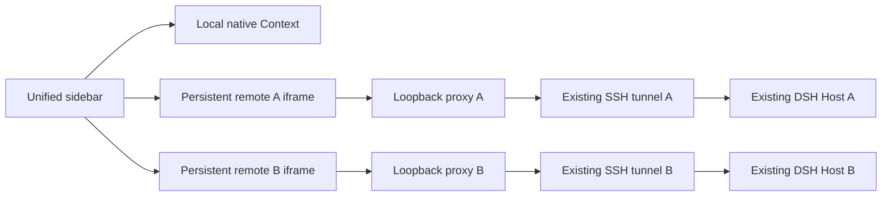

# Architecture and trust boundaries

The local DSH Client Context remains connected to its original Host. The
unified sidebar projects read-only workspace/session catalogs from the local
Host and configured remote Hosts. A source ID is always carried separately
from the native workspace or session ID, so two Hosts may use identical IDs
without sharing a session controller.

Each configured remote has a fixed loopback upstream, credential cache,
authorized HTTP/WS proxy, appearance handler and embedded-frame service.
Request bodies cannot supply an upstream URL, SSH command or credential
program. Unknown Host IDs fail closed. Config IDs are bounded and reserved
prototype names are rejected.

The configuration is an owner-controlled regular file outside the checkout.
The credential executable receives only configured argv through `execFile`;
it is not a shell command. Output is captured privately and validated for
origin, cookie identity and bounded lifetime. Catalog/API responses do not
include the configuration's command, upstream credential or signing secret.

The example SSH signer reads an existing remote browser-session grant,
signs a five-minute authority-bound cookie on the remote host and performs
one authenticated session-list read. It never starts a DSH Host or copies
the signing secret to the client machine.

An embedded page gets its own loopback origin, one-use document nonce,
independent HTTP capability and control-channel token. The proxy serves the
remote's real frontend with a client-only companion. API requests require
an explicit capability header or query; bootstrap HTML is one-use; static
script/style preloads are constrained to code resources. Composite plugin
queries retain their original bytes. Cookies from the parent and frame,
phone device tokens, and frame grants are stripped before forwarding; only
the private remote owner credential is sent upstream.

Parent/child communication checks exact origins, window identity, frame ID,
control token and a single MessagePort. A child accepts a session only after
refreshing its own native session catalog and confirming membership. The
parent never passes a remote ID to the local controller. Closing a frame
cleans up that frame's own observers and network requests.

Only `ui-theme` and `locale` are bridged to the local Host. Remote provider,
model, tool and credential namespaces retain their remote ownership.

Phone mode retains its existing paired Remote Web UI and explicit whole-page
Host selection. Both `/api/remote.mux` and Remote Web UI's rewritten
`/remote/api/remote.mux` are normalized to the selected remote's dedicated
mux route. Local mode continues to use the local mux. A public relay must
forward the plugin's dedicated routes as described in the README.

The package does not implement cross-host credential distribution or a public
phone iframe service. Operators choose server access, SSH lifecycle,
provider configuration and any additional HTTPS ingress explicitly.
